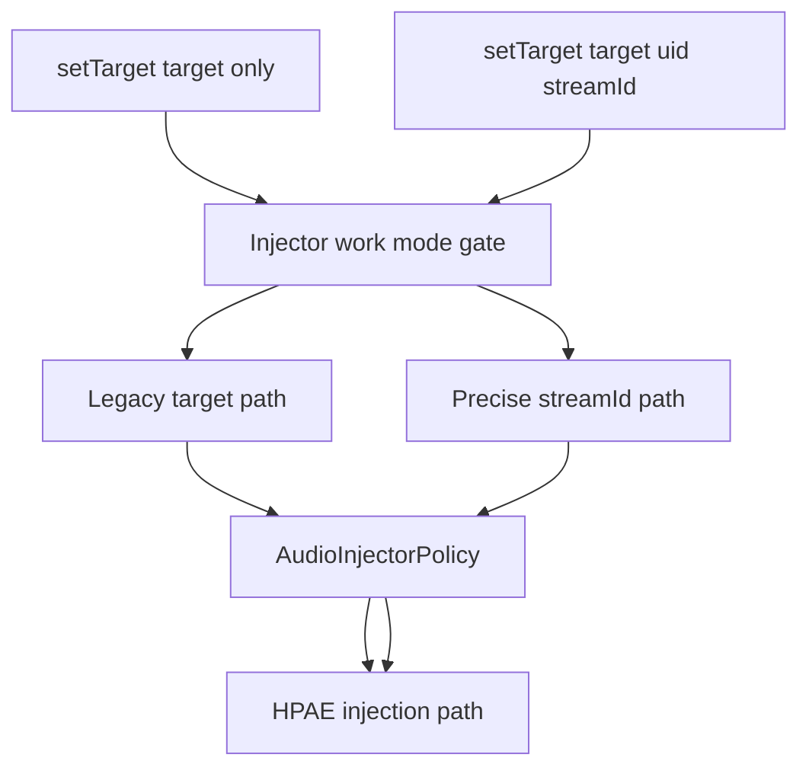
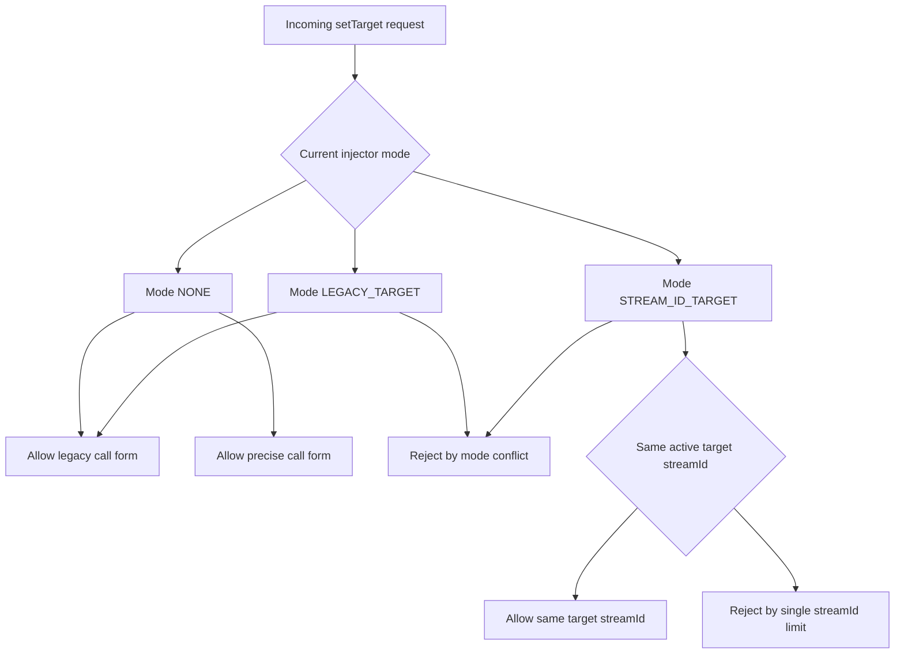
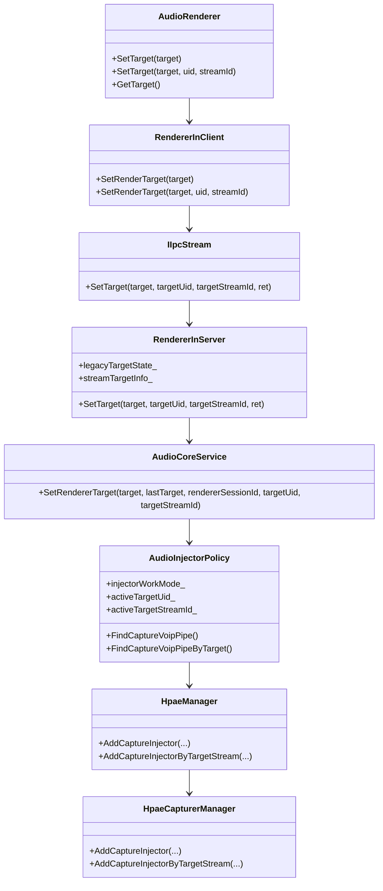
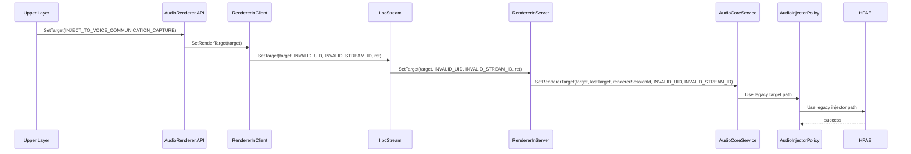
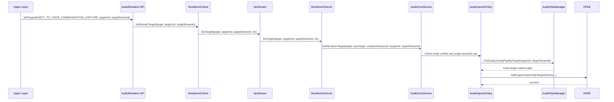
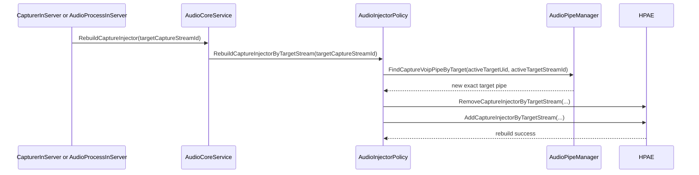

# `setTarget` 扩展可选 `Uid/StreamId` 的 VoIP 定向注入设计文档

## 目录

- [1. 背景](#1-背景)
- [2. 需求与规格定义](#2-需求与规格定义)
- [3. 当前实现分析](#3-当前实现分析)
- [4. 总体方案](#4-总体方案)
- [5. 逻辑视图与类图](#5-逻辑视图与类图)
- [6. API 设计](#6-api-设计)
- [7. Client 与 IPC 设计](#7-client-与-ipc-设计)
- [8. Server / Policy / Injector 设计](#8-server--policy--injector-设计)
- [9. HPAE 设计](#9-hpae-设计)
- [10. 序列图](#10-序列图)
- [11. 接口签名草案](#11-接口签名草案)
- [12. 代码改动清单](#12-代码改动清单)
- [13. 校验规则与错误码](#13-校验规则与错误码)
- [14. 回归与兼容约束](#14-回归与兼容约束)
- [15. 开发任务拆分表](#15-开发任务拆分表)
- [16. 工作量评估](#16-工作量评估)
- [17. 文件级函数清单与伪代码步骤](#17-文件级函数清单与伪代码步骤)
- [18. 评审问题清单](#18-评审问题清单)
- [19. 最终建议](#19-最终建议)

## 1. 背景

当前系统已有一套 `setTarget` 相关逻辑，用于把 renderer 切换到：

- `NORMAL_PLAYBACK`
- `INJECT_TO_VOICE_COMMUNICATION_CAPTURE`

但这套逻辑只能表达：

- “我要进入 VoIP 注入模式”

不能表达：

- “我要注入到哪个应用的哪一条 VoIP 录音流”

现状的粗粒度问题主要体现在三层：

1. **API 层**
   - 公开接口只有 `SetTarget(RenderTarget target)`
   - 没有 `uid`
   - 没有目标 `streamId`
2. **Policy / Injector 层**
   - 默认按“运行中的 VoIP capture 类型”识别目标
   - 没有把“目标 capture identity”作为一等公民
3. **HPAE 层**
   - 注入连接更接近 `SourceType` / cluster 级粒度
   - 还没有做到 session 级精确绑定

另外，虽然仓中仍残留部分 endpoint 旧逻辑，但当前实际工作链路已经以 HPAE 为主，本需求不再沿 endpoint 扩展。

## 2. 需求与规格定义

### 2.1 核心新增能力

不新增新的 set/get 接口名，而是在现有 `setTarget` 上增加两个**可选参数**：

- `targetUid`
- `targetStreamId`

使用方式分成两种调用形态：

1. **旧调用形态**
   - `setTarget(target)`
   - 或内部等价为 `setTarget(target, INVALID_UID, INVALID_STREAM_ID)`
   - 语义保持为原有“按 VoIP 类型注入”逻辑
2. **新调用形态**
   - `setTarget(target, uid, streamId)`
   - 语义为“精确指定目标 VoIP capture 流”

`getTarget` 保持当前实现和语义，不新增新的 getter 接口。

### 2.2 必须满足的规格

#### 规格 A：原有 `setTarget/getTarget` 逻辑全部保留

即：

- `getTarget` 不变
- `setTarget(target)` 的原有行为不变

#### 规格 B：`Uid` 与 `StreamId` 必须同时携带

也就是说，新调用形态必须满足：

- `uid` 有效
- `streamId` 有效

不允许：

- 只带 `uid`
- 只带 `streamId`

否则必须返回参数错误。

#### 规格 C：同一时间旧逻辑与精确流逻辑不允许并发

虽然接口名仍是同一个 `setTarget`，但从行为上仍然有两种工作模式：

1. **Legacy 模式**
   - 按原有 VoIP 类型注入工作
2. **Precise Stream 模式**
   - 按 `uid + streamId` 精确注入工作

两种模式不允许同时存在。

#### 规格 D：精确流模式下，只允许一个目标 `streamId`

允许：

- 多个 renderer 指向同一个目标 `streamId`

不允许：

- 多个 renderer 同时指向不同目标 `streamId`

#### 规格 E：如果设置的 `streamId` 不是 VoIP 类型，必须返回明确错误码

server 侧必须检查：

1. `streamId` 是否存在
2. `streamId` 是否属于目标 `uid`
3. `streamId` 对应的 capture 是否是 VoIP 类型
4. 目标 capture 当前状态是否允许注入

### 2.3 非目标

本期不做：

1. 不新增新的公开 getter，继续只保留 `getTarget`
2. 不新增新的公开 set 接口名称
3. 不支持多目标 `streamId` 并发注入
4. 不把 endpoint 旧链路重新拉回主方案
5. 不扩大到非 VoIP capture 目标

## 3. 当前实现分析

### 3.1 API 层现状

当前公开接口：

- inner API：[`AudioRenderer::SetTarget(RenderTarget target)`](</d:/00_workspace/code/multimedia_audio_framework/interfaces/inner_api/native/audiorenderer/include/audio_renderer.h:1258>)
- renderer private：[`AudioRendererPrivate::SetTarget(RenderTarget target)`](</d:/00_workspace/code/multimedia_audio_framework/frameworks/native/audiorenderer/src/audio_renderer.cpp:3716>)
- NAPI：[`NapiAudioRenderer::SetTarget`](</d:/00_workspace/code/multimedia_audio_framework/frameworks/js/napi/audiorenderer/napi_audio_renderer.cpp:598>)
- Taihe：[`AudioRendererImpl::SetTargetSync`](</d:/00_workspace/code/multimedia_audio_framework/frameworks/taihe/audiorenderer/taihe_audio_renderer.cpp:545>)

问题：

- 只有 `RenderTarget`
- 无法显式指定目标 `uid` 与 `streamId`

### 3.2 client / IPC 层现状

当前链路：

```text
AudioRendererPrivate::SetTarget
  -> IAudioStream::SetRenderTarget
    -> RendererInClientInner::SetRenderTarget
      -> IIpcStream::SetTarget
        -> IpcStreamInServer::SetTarget
          -> RendererInServer::SetTarget
            -> CoreServiceHandler::SetRendererTarget
              -> ICoreServiceProvider / AudioCoreService::SetRendererTarget
```

关键点：

- [`RendererInClientInner::SetRenderTarget`](</d:/00_workspace/code/multimedia_audio_framework/services/audio_service/client/src/renderer_in_client_public.cpp:694>)
- [`IIpcStream::SetTarget`](</d:/00_workspace/code/multimedia_audio_framework/services/audio_service/idl/IIpcStream.idl:72>)
- [`IpcStreamInServer::SetTarget`](</d:/00_workspace/code/multimedia_audio_framework/services/audio_service/server/src/ipc_stream_in_server.cpp:364>)
- [`RendererInServer::SetTarget`](</d:/00_workspace/code/multimedia_audio_framework/services/audio_service/server/src/renderer_in_server.cpp:3308>)

问题：

- 全链路只有 `target`
- 没有为“可选 `uid + streamId` 的新调用形态”预留参数

### 3.3 policy / injector 侧现状

#### `AudioCoreService`

当前：

- [`AudioCoreService::SetRendererTarget`](</d:/00_workspace/code/multimedia_audio_framework/services/audio_policy/server/service/service_main/src/audio_core_service.cpp:3030>)
- [`AudioCoreService::StartInjection`](</d:/00_workspace/code/multimedia_audio_framework/services/audio_policy/server/service/service_main/src/audio_core_service.cpp:3047>)

特点：

- 旧逻辑只知道 renderer 的 `sessionId`
- 实际目标 capture 由系统内部推导

#### `AudioInjectorPolicy`

当前关键函数：

- [`AudioInjectorPolicy::AddStreamDescriptor`](</d:/00_workspace/code/multimedia_audio_framework/services/audio_policy/server/service/service_main/src/audio_injector_policy.cpp:99>)
- [`AudioInjectorPolicy::AddCaptureInjectorInner`](</d:/00_workspace/code/multimedia_audio_framework/services/audio_policy/server/service/service_main/src/audio_injector_policy.cpp:266>)
- [`AudioInjectorPolicy::RemoveCaptureInjectorInner`](</d:/00_workspace/code/multimedia_audio_framework/services/audio_policy/server/service/service_main/src/audio_injector_policy.cpp:292>)
- [`AudioInjectorPolicy::FindCaptureVoipPipe`](</d:/00_workspace/code/multimedia_audio_framework/services/audio_policy/server/service/service_main/src/audio_injector_policy.cpp:320>)
- [`AudioInjectorPolicy::FindPipeByStreamId`](</d:/00_workspace/code/multimedia_audio_framework/services/audio_policy/server/service/service_main/src/audio_injector_policy.cpp:346>)

问题：

1. 默认按“任意运行中的 VoIP capture”或单全局 `capturePortIdx_` 工作
2. 没有“旧调用形态 / 新调用形态”的显式仲裁
3. 没有 `targetUid + targetStreamId` 的全局绑定状态

### 3.4 HPAE 侧现状

#### HPAE manager 入口

当前入口：

- [`HpaeManager::AddCaptureInjector(sinkPortIndex, sourcePortIndex, sourceType)`](</d:/00_workspace/code/multimedia_audio_framework/services/audio_engine/manager/src/hpae_manager.cpp:2876>)
- [`HpaeManager::RemoveCaptureInjector(...)`](</d:/00_workspace/code/multimedia_audio_framework/services/audio_engine/manager/src/hpae_manager.cpp:2897>)

说明：

- 这里已经有 `sourcePortIndex`
- 所以 policy 如果能精确找到目标 pipe，manager 入口本身可以支持精细定位

#### 普通 capturer manager

当前：

- [`HpaeCapturerManager::AddCaptureInjector`](</d:/00_workspace/code/multimedia_audio_framework/services/audio_engine/manager/src/hpae_capturer_manager.cpp:1279>)
- [`HpaeCapturerManager::RemoveCaptureInjector`](</d:/00_workspace/code/multimedia_audio_framework/services/audio_engine/manager/src/hpae_capturer_manager.cpp:1297>)

问题：

- 仍然按 `SourceType -> sceneCluster`
- 最终调用 `sceneCluster->ConnectInjector(sinkOutputNode)`
- 粒度是 cluster，不是目标 session

#### fast capturer manager

当前：

- [`HpaeFastCapturerManager::AddCaptureInjector`](</d:/00_workspace/code/multimedia_audio_framework/services/audio_engine/manager/src/hpae_fast_capturer_manager.cpp:700>)
- [`HpaeFastCapturerManager::RemoveCaptureInjector`](</d:/00_workspace/code/multimedia_audio_framework/services/audio_engine/manager/src/hpae_fast_capturer_manager.cpp:717>)

问题：

- converter 节点 key 不包含目标 `streamId`
- 也不是 stream 级目标模型

#### 全局注入态

当前：

- [`HpaeSourceInputCluster::SetInjectState`](</d:/00_workspace/code/multimedia_audio_framework/services/audio_engine/node/include/hpae_source_input_cluster.h:54>)
- [`HpaeSourceInputNode::SetInjectState`](</d:/00_workspace/code/multimedia_audio_framework/services/audio_engine/node/src/hpae_source_input_node.cpp:755>)

问题：

- 只有全局 `isInjecting_`
- 不能表达“对哪个目标 session 正在注入”

### 3.5 endpoint 旧逻辑

旧逻辑：

- [`AudioServer::AddCaptureInjector`](</d:/00_workspace/code/multimedia_audio_framework/services/audio_service/server/src/audio_server.cpp:3822>)
- [`AudioServer::RemoveCaptureInjector`](</d:/00_workspace/code/multimedia_audio_framework/services/audio_service/server/src/audio_server.cpp:3841>)

说明：

- 依赖 endpoint
- 当前不再作为本需求扩展主链路

## 4. 总体方案

### 4.1 一个接口，两种调用形态

本次总体思路不是双接口，而是**一个 `setTarget` 接口，两种调用形态**：

#### 调用形态 A：原有调用形态

```cpp
setTarget(target)
```

或内部等价：

```cpp
setTarget(target, INVALID_UID, INVALID_STREAM_ID)
```

语义：

- 保持原有“按 VoIP 类型注入”的逻辑

#### 调用形态 B：扩展调用形态

```cpp
setTarget(target, targetUid, targetStreamId)
```

语义：

- 按 `uid + streamId` 精确指定目标 VoIP capture

### 4.2 工作模式仲裁

虽然公开 API 仍叫同一个 `setTarget`，但从内部实现上，仍然存在两种工作模式：

```cpp
enum InjectorWorkMode {
    INJECTOR_MODE_NONE = 0,
    INJECTOR_MODE_LEGACY_TARGET = 1,
    INJECTOR_MODE_STREAM_ID_TARGET = 2,
};
```

规则：

1. 没有任何注入时：`NONE`
2. 通过旧调用形态进入 inject：`LEGACY_TARGET`
3. 通过扩展调用形态进入 inject：`STREAM_ID_TARGET`
4. 两种模式互斥

### 4.3 单一目标 `streamId` 限制

在 `STREAM_ID_TARGET` 模式下：

- 允许多个 renderer 指向同一个 `streamId`
- 不允许多个 renderer 指向不同 `streamId`

建议维护：

```cpp
int32_t activeTargetUid_ = INVALID_UID;
uint32_t activeTargetStreamId_ = INVALID_STREAM_ID;
```

## 5. 逻辑视图与类图

### 5.1 调用形态逻辑视图



### 5.2 模式仲裁视图



### 5.3 类图



## 6. API 设计

### 6.1 inner API

保留原接口：

```cpp
virtual int32_t SetTarget(RenderTarget target);
virtual RenderTarget GetTarget() const;
```

扩展同名重载：

```cpp
virtual int32_t SetTarget(RenderTarget target,
    int32_t targetUid,
    uint32_t targetStreamId);
```

说明：

- 对外仍然只有 `setTarget`
- 没有新增新的 set/get 名称
- `getTarget` 保持当前实现

### 6.2 `getTarget` 语义保持不变

`getTarget` 继续只返回：

- 当前 `RenderTarget`

不负责对外暴露：

- `uid`
- `streamId`

如果后续确实需要观测新模式内部状态，应通过 dump / debug / internal state 解决，而不是改公开 getter 语义。

### 6.3 可选参数约束

对外约束明确如下：

1. 旧调用形态：
   - `setTarget(target)`
2. 扩展调用形态：
   - `setTarget(target, uid, streamId)`
3. `uid` 和 `streamId` 必须成对携带
4. 不能只携带其中一个

## 7. Client 与 IPC 设计

### 7.1 client 层

#### 7.1.1 旧逻辑保留

保留：

- `RendererInClientInner::SetRenderTarget(RenderTarget target)`

其行为不变。

#### 7.1.2 扩展同名重载

新增：

- `RendererInClientInner::SetRenderTarget(RenderTarget target, int32_t targetUid, uint32_t targetStreamId)`

client 只负责：

1. 参数完整性校验
2. 透传给 IPC
3. 本地缓存精确目标状态

### 7.2 `IIpcStream`

由于 IDL 不适合做同名重载，建议直接扩展现有 `SetTarget` 方法签名：

当前：

```idl
void SetTarget([in] int target, [out] int ret);
```

建议改为：

```idl
void SetTarget(
    [in] int target,
    [in] int targetUid,
    [in] unsigned int targetStreamId,
    [out] int ret);
```

约定：

- `targetUid == INVALID_UID` 且 `targetStreamId == INVALID_STREAM_ID`
  - 表示旧调用形态
- `targetUid` 和 `targetStreamId` 同时有效
  - 表示精确目标调用形态
- 只带一个有效值
  - `ERR_INVALID_PARAM`

### 7.3 `IpcStreamInServer`

保留旧行为的同时，签名统一扩展：

```cpp
int32_t SetTarget(int32_t target, int32_t targetUid, uint32_t targetStreamId, int32_t &ret)
```

内部透传到：

- `RendererInServer::SetTarget(target, targetUid, targetStreamId, ret)`

## 8. Server / Policy / Injector 设计

### 8.1 `RendererInServer`

不新增新的对外接口名，直接扩展现有 `SetTarget`：

当前：

```cpp
int32_t SetTarget(RenderTarget target, int32_t &ret)
```

建议改为：

```cpp
int32_t SetTarget(RenderTarget target,
    int32_t targetUid,
    uint32_t targetStreamId,
    int32_t &ret)
```

并区分两种调用形态：

1. `targetUid/targetStreamId` 都无效
   - 走旧逻辑
2. `targetUid/targetStreamId` 都有效
   - 走精确目标逻辑
3. 只一个有效
   - 返回 `ERR_INVALID_PARAM`

### 8.2 `CoreServiceHandler` / `ICoreServiceProvider` / `ICoreServiceProviderIpc`

同样不新增新的方法名，直接扩展现有 `SetRendererTarget`：

```cpp
SetRendererTarget(RenderTarget target,
                  RenderTarget lastTarget,
                  uint32_t rendererSessionId,
                  int32_t targetUid,
                  uint32_t targetStreamId)
```

### 8.3 `AudioCoreService`

扩展现有：

```cpp
int32_t SetRendererTarget(RenderTarget target,
                          RenderTarget lastTarget,
                          uint32_t rendererSessionId,
                          int32_t targetUid,
                          uint32_t targetStreamId)
```

内部流程：

1. 判断调用形态
2. 如果是旧形态：
   - 完整保留原有实现
3. 如果是精确形态：
   - 走新逻辑

### 8.4 精确形态校验流程

server 侧在 `AudioCoreService::SetRendererTarget` 中新增：

1. `targetUid` 和 `targetStreamId` 必须同时有效，或同时无效
2. 如果为精确形态：
   - `targetStreamId` 存在
   - `targetStreamId` 属于 `targetUid`
   - 对应流是 capture
   - `capturerInfo_.sourceType == SOURCE_TYPE_VOICE_COMMUNICATION`
   - 对应流是 running
3. 校验模式互斥
4. 校验单一目标 `streamId` 约束

### 8.5 模式仲裁规则

| 当前模式 | 请求形态 | 结果 |
| --- | --- | --- |
| `NONE` | 旧形态 | 允许，进入 `LEGACY_TARGET` |
| `NONE` | 精确形态 | 允许，进入 `STREAM_ID_TARGET` |
| `LEGACY_TARGET` | 旧形态 | 沿用旧逻辑 |
| `LEGACY_TARGET` | 精确形态 | 拒绝，`ERR_NOT_SUPPORTED` |
| `STREAM_ID_TARGET` | 旧形态 | 拒绝，`ERR_NOT_SUPPORTED` |
| `STREAM_ID_TARGET` | 精确形态，且相同 `streamId` | 允许 |
| `STREAM_ID_TARGET` | 精确形态，但不同 `streamId` | 拒绝，`ERR_NOT_SUPPORTED` |

### 8.6 `AudioInjectorPolicy`

旧逻辑：

- `AddCaptureInjector()`
- `RemoveCaptureInjector()`
- `FindCaptureVoipPipe(...)`

全部保留不变。

新增状态：

```cpp
InjectorWorkMode injectorWorkMode_ = INJECTOR_MODE_NONE;
int32_t activeTargetUid_ = INVALID_UID;
uint32_t activeTargetStreamId_ = INVALID_STREAM_ID;
std::unordered_map<uint32_t, int32_t> rendererTargetUidMap_;
std::unordered_map<uint32_t, uint32_t> rendererTargetStreamIdMap_;
```

新增逻辑：

- `CanEnterPreciseMode(...)`
- `FindCaptureVoipPipeByTarget(...)`
- `AddCaptureInjectorByTargetStream(...)`
- `RemoveCaptureInjectorByTargetStream(...)`
- `RebuildCaptureInjectorByTargetStream(...)`

注意：

- 旧模式和精确模式共存于同一个 policy 类
- 但状态互斥

## 9. HPAE 设计

### 9.1 旧链路保留

旧函数保留：

- `HpaeManager::AddCaptureInjector`
- `HpaeCapturerManager::AddCaptureInjector`
- `HpaeFastCapturerManager::AddCaptureInjector`

这些继续服务旧调用形态。

### 9.2 精确形态新增内部 helper

由于用户只限制公开 `set/get` 接口，不限制内部 helper，因此 HPAE 层建议新增新的内部 helper 名称，而不是硬改旧函数语义。

建议新增：

```cpp
HpaeManager::AddCaptureInjectorByTargetStream(...)
HpaeManager::RemoveCaptureInjectorByTargetStream(...)
HpaeCapturerManager::AddCaptureInjectorByTargetStream(...)
HpaeCapturerManager::RemoveCaptureInjectorByTargetStream(...)
HpaeFastCapturerManager::AddCaptureInjectorByTargetStream(...)
HpaeFastCapturerManager::RemoveCaptureInjectorByTargetStream(...)
```

### 9.3 普通 capturer manager

旧逻辑：

- `sceneCluster->ConnectInjector(sinkOutputNode)`

精确形态：

1. 从 `sourceOutputNodeMap_[targetSessionId]` 找目标 session
2. 只把 injector 接到该目标 session 分支
3. 不继续接公共 cluster 输出

### 9.4 fast capturer manager

精确形态建议：

- 使用 `(sinkOutputNode, targetSessionId)` 作为 converter map key
- 保证多个不同目标 session 不会串扰

### 9.5 注入态状态位

当前全局：

- `isInjecting_`

建议新增：

```cpp
std::unordered_set<uint32_t> injectingSessionIds_;
```

并用：

```cpp
isInjecting_ = !injectingSessionIds_.empty();
```

表示当前是否存在任意精确目标注入会话。

## 10. 序列图

### 10.1 旧调用形态保持不变



### 10.2 精确调用形态



### 10.3 目标 capture rebuild



## 11. 接口签名草案

### 11.1 inner API

```cpp
class AudioRenderer {
public:
    virtual int32_t SetTarget(RenderTarget target) = 0;

    virtual int32_t SetTarget(RenderTarget target,
        int32_t targetUid,
        uint32_t targetStreamId) = 0;

    virtual RenderTarget GetTarget() const = 0;
};
```

### 11.2 `IAudioStream`

```cpp
class IAudioStream {
public:
    virtual int32_t SetRenderTarget(RenderTarget target) = 0;

    virtual int32_t SetRenderTarget(RenderTarget target,
        int32_t targetUid,
        uint32_t targetStreamId) = 0;

    virtual RenderTarget GetRenderTarget() = 0;
};
```

### 11.3 `IIpcStream.idl`

```idl
void SetTarget(
    [in] int target,
    [in] int targetUid,
    [in] unsigned int targetStreamId,
    [out] int ret);
```

约定：

- 旧形态：`targetUid == INVALID_UID` 且 `targetStreamId == INVALID_STREAM_ID`
- 精确形态：`targetUid` 和 `targetStreamId` 同时有效

### 11.4 `ICoreServiceProviderIpc.idl`

```idl
void SetRendererTarget(
    [in] unsigned int target,
    [in] unsigned int lastTarget,
    [in] unsigned int rendererSessionId,
    [in] int targetUid,
    [in] unsigned int targetStreamId,
    [out] int ret);
```

## 12. 代码改动清单

### 12.1 公开层

- `interfaces/inner_api/native/audiorenderer/include/audio_renderer.h`
- `frameworks/native/audiorenderer/include/shared_audio_renderer_wrapper.h`
- `frameworks/native/audiorenderer/include/audio_renderer_private.h`
- `frameworks/native/audiorenderer/src/audio_renderer.cpp`
- `frameworks/js/napi/audiorenderer/napi_audio_renderer.cpp`
- `frameworks/js/napi/audiorenderer/napi_audio_renderer.h`
- `frameworks/taihe/audiorenderer/taihe_audio_renderer.cpp`
- `frameworks/taihe/audiorenderer/taihe_audio_renderer.h`

### 12.2 client / IPC 层

- `frameworks/native/audiostream/include/i_audio_stream.h`
- `services/audio_service/idl/IIpcStream.idl`
- `services/audio_service/client/src/renderer_in_client_public.cpp`
- `services/audio_service/server/include/ipc_stream_in_server.h`
- `services/audio_service/server/src/ipc_stream_in_server.cpp`

### 12.3 server / policy / injector 层

- `services/audio_service/server/include/renderer_in_server.h`
- `services/audio_service/server/src/renderer_in_server.cpp`
- `services/audio_service/server/include/core_service_handler.h`
- `services/audio_service/server/src/core_service_handler.cpp`
- `services/audio_service/common/include/i_core_service_provider.h`
- `services/audio_service/idl/ICoreServiceProviderIpc.idl`
- `services/audio_service/client/include/core_service_provider_stub.h`
- `services/audio_service/client/src/core_service_provider_stub.cpp`
- `services/audio_policy/server/service/service_main/include/audio_core_service.h`
- `services/audio_policy/server/service/service_main/src/audio_core_service_entry.cpp`
- `services/audio_policy/server/service/service_main/src/audio_core_service.cpp`
- `services/audio_policy/server/service/service_main/include/audio_injector_policy.h`
- `services/audio_policy/server/service/service_main/src/audio_injector_policy.cpp`
- `frameworks/native/audiodefinitions/include/audio_stream_descriptor.h`

### 12.4 HPAE 层

- `services/audio_engine/manager/include/i_hpae_manager.h`
- `services/audio_engine/manager/include/hpae_manager.h`
- `services/audio_engine/manager/src/hpae_manager.cpp`
- `services/audio_engine/manager/include/i_hpae_capturer_manager.h`
- `services/audio_engine/manager/include/hpae_capturer_manager.h`
- `services/audio_engine/manager/include/hpae_fast_capturer_manager.h`
- `services/audio_engine/manager/src/hpae_capturer_manager.cpp`
- `services/audio_engine/manager/src/hpae_fast_capturer_manager.cpp`
- `services/audio_engine/node/include/hpae_source_process_cluster.h`
- `services/audio_engine/node/src/hpae_source_process_cluster.cpp`
- `services/audio_engine/node/include/hpae_source_input_cluster.h`
- `services/audio_engine/node/include/hpae_source_input_node.h`
- `services/audio_engine/node/src/hpae_source_input_cluster.cpp`
- `services/audio_engine/node/src/hpae_source_input_node.cpp`

## 13. 校验规则与错误码

### 13.1 参数规则

| 调用形态 | 规则 |
| --- | --- |
| `setTarget(target)` | 合法，旧逻辑 |
| `setTarget(target, INVALID_UID, INVALID_STREAM_ID)` | 合法，等价旧逻辑 |
| `setTarget(target, validUid, validStreamId)` | 合法，精确形态 |
| `setTarget(target, validUid, INVALID_STREAM_ID)` | `ERR_INVALID_PARAM` |
| `setTarget(target, INVALID_UID, validStreamId)` | `ERR_INVALID_PARAM` |

### 13.2 目标流校验规则

精确形态进入 server 后，必须按顺序校验：

1. `targetStreamId` 存在
2. `targetStreamId` 属于 `targetUid`
3. 对应流是 capture
4. `capturerInfo_.sourceType == SOURCE_TYPE_VOICE_COMMUNICATION`
5. 对应流当前是 running

### 13.3 模式冲突错误码

| 场景 | 错误码 |
| --- | --- |
| 当前处于 legacy 模式，又调用精确形态 | `ERR_NOT_SUPPORTED` |
| 当前处于精确模式，又调用 legacy inject 形态 | `ERR_NOT_SUPPORTED` |
| 当前精确模式下请求不同目标 `streamId` | `ERR_NOT_SUPPORTED` |
| 目标流存在但不是 VoIP capture | `ERR_NOT_SUPPORTED` |
| 目标流存在但未 running | `ERR_ILLEGAL_STATE` |

## 14. 回归与兼容约束

1. 原 `setTarget/getTarget` 逻辑必须完整保留。
2. 新增逻辑不能改变旧路径返回值和时序。
3. 模式冲突时，必须显式返回错误，不能悄悄降级到另一条路径。
4. 精确形态若失败，不能误连到任意 VoIP 流。

## 15. 开发任务拆分表

| 任务包 | 主要内容 | 依赖 |
| --- | --- | --- |
| P1 | `setTarget` 扩参设计与 wrapper 改造 | 无 |
| P2 | `IIpcStream` / `ICoreServiceProviderIpc` 扩参透传 | P1 |
| P3 | `RendererInClient` / `RendererInServer` 改造 | P2 |
| P4 | `AudioCoreService` 调用形态识别与目标流校验 | P3 |
| P5 | `AudioInjectorPolicy` 模式仲裁与单目标限制 | P4 |
| P6 | HPAE 精确形态内部 helper 落地 | P5 |
| P7 | 单测、模块测试、联调、回归 | P1~P6 |

## 16. 工作量评估

### 16.1 估算前提

本次估算按完整交付链路进行，主要考虑以下事实：

1. 不是替换，而是保留旧逻辑再扩展新调用形态
2. API、IPC、server、policy、HPAE 全链路都要兼容旧逻辑
3. 端到端回归面显著扩大
4. HPAE 仍然是最高技术风险层

### 16.2 分层工作量

| 模块 | 主要内容 | 工作量 |
| --- | --- | --- |
| API / wrapper | `AudioRenderer`、wrapper、NAPI、Taihe 的扩参和兼容处理 | 5 ~ 8 人日 |
| client / IPC | `IAudioStream`、`IIpcStream`、`ICoreServiceProviderIpc` 扩参透传 | 5 ~ 8 人日 |
| server / core service | `RendererInServer`、`CoreServiceHandler`、`AudioCoreService` 逻辑改造 | 10 ~ 16 人日 |
| injector policy | 模式仲裁、目标流校验、单目标约束、rebuild 逻辑 | 10 ~ 16 人日 |
| HPAE manager / node | session 级注入链、状态位改造、fast/normal 双路径适配 | 15 ~ 24 人日 |
| 单元测试补充 | API、IPC、policy、HPAE 层新增与回归单测 | 8 ~ 12 人日 |
| 集成联调与系统回归 | 设备切换、重建、冲突场景、端到端回归 | 14 ~ 22 人日 |

### 16.3 总工作量

建议总体评估：

- 设计与实现：`45 ~ 72 人日`
- 测试与联调：`22 ~ 34 人日`
- 总计：`67 ~ 106 人日`
- 约：`14 ~ 22 人周`

## 17. 文件级函数清单与伪代码步骤

### 17.1 `audio_renderer.cpp`

#### 需要修改

- `AudioRendererPrivate::SetTarget(RenderTarget target)`
- 新增重载 `AudioRendererPrivate::SetTarget(RenderTarget target, int32_t targetUid, uint32_t targetStreamId)`

#### 伪代码

```cpp
旧形态:
    1. 走原有逻辑

扩展形态:
    1. 校验 uid/streamId 成对出现
    2. 获取 currentStream
    3. 调 currentStream->SetRenderTarget(target, targetUid, targetStreamId)
    4. 记录内部 streamTargetInfo_
```

### 17.2 `renderer_in_client_public.cpp`

#### 需要修改

- 保留现有 `RendererInClientInner::SetRenderTarget(RenderTarget target)`
- 新增重载 `RendererInClientInner::SetRenderTarget(RenderTarget target, int32_t targetUid, uint32_t targetStreamId)`

#### 伪代码

```cpp
如果 uid/streamId 都无效:
    ipcStream_->SetTarget(target, INVALID_UID, INVALID_STREAM_ID, ret)

如果 uid/streamId 都有效:
    ipcStream_->SetTarget(target, targetUid, targetStreamId, ret)

否则:
    return ERR_INVALID_PARAM
```

### 17.3 `renderer_in_server.cpp`

#### 需要修改

- 现有 `SetTarget` 改为统一接收扩展参数

#### 伪代码

```cpp
if (targetUid/targetStreamId 都无效):
    走旧逻辑
else if (targetUid/targetStreamId 都有效):
    走精确形态逻辑
else:
    return ERR_INVALID_PARAM
```

### 17.4 `audio_core_service.cpp`

#### 需要修改

- `SetRendererTarget(...)`

#### 伪代码

```cpp
if (targetUid/targetStreamId 都无效):
    调 legacy target path
else if (targetUid/targetStreamId 都有效):
    1. 校验目标 stream
    2. 校验模式冲突
    3. 校验单目标 streamId 约束
    4. 调 injector precise path
else:
    return ERR_INVALID_PARAM
```

### 17.5 `audio_injector_policy.cpp`

#### 需要修改

- `Set mode`
- `FindCaptureVoipPipeByTarget`
- `AddCaptureInjectorByTargetStream`
- `RemoveCaptureInjectorByTargetStream`
- `RebuildCaptureInjectorByTargetStream`

#### 伪代码

```cpp
if legacy mode active and precise call arrives:
    return ERR_NOT_SUPPORTED

if precise mode active and legacy call arrives:
    return ERR_NOT_SUPPORTED

if precise mode active and different target streamId arrives:
    return ERR_NOT_SUPPORTED

if target stream is not voip:
    return ERR_NOT_SUPPORTED
```

### 17.6 HPAE

#### 需要修改

- 保留原 `AddCaptureInjector`
- 新增 `AddCaptureInjectorByTargetStream`

#### 伪代码

```cpp
legacy path:
    保持原有 cluster 级连接

precise path:
    1. 按 targetSessionId 找 sourceOutputNode
    2. 只连该 session 分支
    3. 更新 injectingSessionIds_
```

## 18. 评审问题清单

### 18.1 为什么不用新接口名

答：

- 规格已经要求不再通过新增 set/get 接口名实现。
- 现有 `setTarget` 扩展可选参数，比新增并行公开接口更符合对外接口约束。

### 18.2 为什么仍然要保留两种内部工作模式

答：

- 虽然公开接口名只有一个 `setTarget`，但调用形态实际上有两种。
- 内部仍需要区分 legacy 与 precise 两种路径，否则无法满足互斥和兼容。

### 18.3 为什么 `uid` 与 `streamId` 必须成对出现

答：

- 只带其中一个无法唯一定位目标 capture。
- 如果允许只带一个，会导致 server 侧出现模糊匹配，重新引入旧问题。

### 18.4 为什么不同 `streamId` 不能并发

答：

- 当前 injector 全局资源模型和 HPAE 连接模型都不是多目标设计。
- 支持不同目标并发会显著扩大改造范围和回归面。

### 18.5 为什么非 VoIP `streamId` 返回 `ERR_NOT_SUPPORTED`

答：

- 目标流存在，但能力边界不支持，因此应返回“不支持”而不是“参数错误”。

### 18.6 为什么工作量仍然较大

答：

- 原因不在于多了两个参数，而在于：
  - 旧逻辑必须完全保留
  - 新旧调用形态互斥
  - HPAE 要加一套精确路径
  - 测试与回归成本远高于编码成本

## 19. 最终建议

1. 公开 API 统一保持 `setTarget` 名字，只扩展可选参数。
2. `getTarget` 不变，不新增新的 getter。
3. 内部实现必须显式区分“旧调用形态”和“精确调用形态”。
4. 任何只带 `uid` 或只带 `streamId` 的调用，都必须返回 `ERR_INVALID_PARAM`。
5. 非 VoIP `streamId` 必须返回 `ERR_NOT_SUPPORTED`。
6. 排期时建议按 `67 ~ 106 人日` 的量级准备资源，并预留跨层联调和系统回归缓冲。
