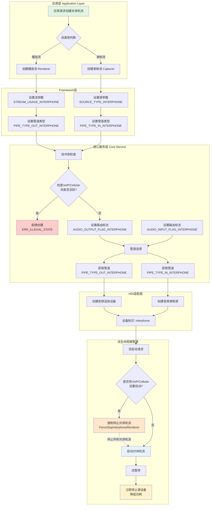
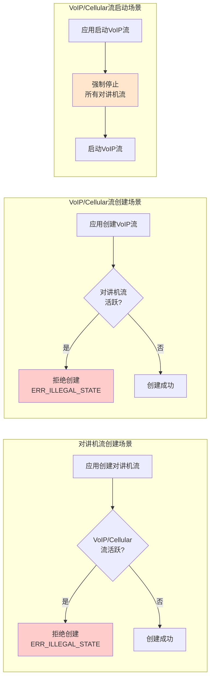
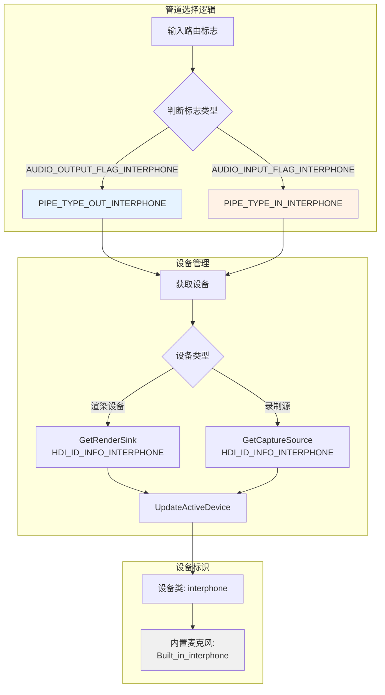
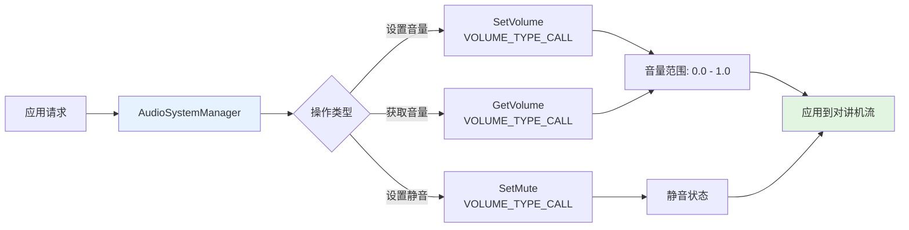
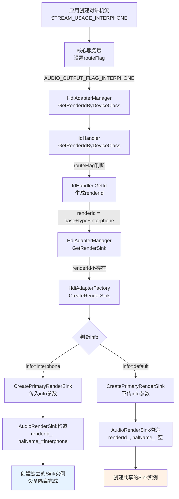

# 对讲机业务流程文档

## 一、概述

对讲机(Interphone)是音频框架中的一个特殊业务场景,提供了半双工的对讲通信功能。本文档基于代码仓库梳理了对讲机业务的完整流程,包括音频流定义、管道管理、冲突处理、设备管理等核心机制。

## 二、对讲机业务总体流程图

### 2.1 整体架构流程



### 2.2 流冲突处理流程



### 2.3 设备管理与管道选择流程



### 2.4 音量控制流程



## 三、核心概念与定义

### 3.1 音频流类型

对讲机业务涉及以下关键类型定义:

#### 流使用类型 (StreamUsage)
- `STREAM_USAGE_INTERPHONE = 24`: 对讲机播放流使用类型
- 定义位置: `interfaces/inner_api/native/audiocommon/include/audio_stream_info.h:71`

#### 录制源类型 (SourceType)
- `SOURCE_TYPE_INTERPHONE = 20`: 对讲机录制流源类型
- 定义位置: `interfaces/inner_api/native/audiocommon/include/audio_source_type.h:46`

#### 流类型 (AudioStreamType)
- `STREAM_INTERPHONE = 31`: 对讲机流类型
- 定义位置: `interfaces/inner_api/native/audiocommon/include/audio_stream_info_ext.h:176`

### 3.2 管道类型

对讲机使用独立的管道类型:

- `PIPE_TYPE_OUT_INTERPHONE = 19`: 对讲机下行管道(播放)
- `PIPE_TYPE_IN_INTERPHONE = 20`: 对讲机上行管道(录制)
- 定义位置: `interfaces/inner_api/native/audiocommon/include/audio_stream_info.h:115-116`

### 3.3 路由标志

对讲机有专用的路由标志:

- `AUDIO_OUTPUT_FLAG_INTERPHONE = 0x1000000`: 对讲机输出标志
- `AUDIO_INPUT_FLAG_INTERPHONE = 0x800000`: 对讲机输入标志
- 定义位置: `interfaces/inner_api/native/audiocommon/include/audio_pipe_types.h:70,83`

### 3.4 HDI设备标识

- 设备类型: `HDI_ID_TYPE_INTERPHONE`
- 设备信息: `HDI_ID_INFO_INTERPHONE = "interphone"`
- 定义位置: `frameworks/native/hdiadapter_new/include/common/hdi_adapter_info.h:45,71`

## 四、业务流程详解

### 4.1 创建播放流(Renderer)流程

#### 流程步骤:

1. **应用层创建Renderer**
   - 应用创建 `AudioRenderer` 实例
   - 设置流参数,指定 `streamUsage = STREAM_USAGE_INTERPHONE`

2. **Framework层处理**
   - 代码位置: `frameworks/native/audiorenderer/src/audio_renderer.cpp:1068`
   - 设置管道类型: `rendererInfo_.pipeType = PIPE_TYPE_OUT_INTERPHONE`

3. **核心服务层流冲突检查**
   - 代码位置: `services/audio_policy/server/service/service_main/src/audio_core_service.cpp:648-657`
   - **关键检查**: 检查VoIP/Cellular流是否活跃
   ```cpp
   if (streamDesc->rendererInfo_.streamUsage == STREAM_USAGE_INTERPHONE) {
       if (pipeManager_->IsVoipOrCellularStreamActive()) {
           AUDIO_ERR_LOG("Cannot create interphone renderer: VoIP or Cellular stream is active");
           return ERR_ILLEGAL_STATE;
       }
       audioFlag = AUDIO_OUTPUT_FLAG_INTERPHONE;
       streamDesc->audioFlag_ = AUDIO_OUTPUT_FLAG_INTERPHONE;
       streamDesc->routeFlag_ = AUDIO_OUTPUT_FLAG_INTERPHONE;
   }
   ```

4. **管道选择**
   - 代码位置: `services/audio_policy/server/domain/pipe/src/audio_pipe_selector.cpp:1261-1262`
   ```cpp
   else if (flag & AUDIO_OUTPUT_FLAG_INTERPHONE) {
       return PIPE_TYPE_OUT_INTERPHONE;
   }
   ```

5. **HDI层创建**
   - 创建对讲机专用的音频渲染设备
   - 设备名称包含 "interphone" 标识

### 4.2 创建录制流(Capturer)流程

#### 流程步骤:

1. **应用层创建Capturer**
   - 应用创建 `AudioCapturer` 实例
   - 设置流参数,指定 `sourceType = SOURCE_TYPE_INTERPHONE`

2. **核心服务层流冲突检查**
   - 代码位置: `services/audio_policy/server/service/service_main/src/audio_core_service.cpp:751-756`
   - **关键检查**: 检查VoIP/Cellular流是否活跃
   ```cpp
   if (streamDesc->capturerInfo_.sourceType == SOURCE_TYPE_INTERPHONE) {
       if (pipeManager_->IsVoipOrCellularStreamActive()) {
           AUDIO_ERR_LOG("Cannot create interphone capturer: VoIP or Cellular stream is active");
           return ERR_ILLEGAL_STATE;
       }
   }
   ```

3. **管道选择**
   - 代码位置: `services/audio_policy/server/domain/pipe/src/audio_pipe_selector.cpp:1229-1230`
   ```cpp
   else if (flag & AUDIO_INPUT_FLAG_INTERPHONE) {
       return PIPE_TYPE_IN_INTERPHONE;
   }
   ```

4. **HDI层设备更新**
   - 代码位置: `services/audio_service/server/src/audio_server.cpp:424-428`
   ```cpp
   std::shared_ptr<IAudioCaptureSource> interphoneSource =
       GetSourceByProp(HDI_ID_TYPE_PRIMARY, HDI_ID_INFO_INTERPHONE);
   if (interphoneSource != nullptr && interphoneSource->IsInited()) {
       interphoneSource->UpdateActiveDevice(type);
   }
   ```

### 4.3 流启动流程

#### 流程步骤:

1. **启动前检查**
   - 代码位置: `services/audio_policy/server/service/service_main/src/audio_core_service.cpp:1490-1491`
   - **强制停止机制**: 如果有VoIP/Cellular流要启动,强制停止对讲机流
   ```cpp
   ForceStopInterphoneStreamsIfNecessary(streamDesc);
   ```

2. **强制停止实现**
   - 代码位置: `services/audio_policy/server/service/service_main/src/audio_core_service.cpp:1536-1562`
   - 停止对讲机播放流:
   ```cpp
   std::vector<std::shared_ptr<AudioStreamDescriptor>> interphoneRenderers =
       pipeManager_->GetStreamDescsByStreamUsage(STREAM_USAGE_INTERPHONE);
   for (auto &streamDesc : interphoneRenderers) {
       if (streamDesc != nullptr && streamDesc->streamStatus_ != STREAM_STATUS_STOPPED) {
           pipeManager_->StopClient(streamDesc->sessionId_);
       }
   }
   ```
   - 停止对讲机录制流:
   ```cpp
   std::vector<std::shared_ptr<AudioStreamDescriptor>> interphoneCapturers =
       pipeManager_->GetStreamDescsBySourceType(SOURCE_TYPE_INTERPHONE);
   for (auto &streamDesc : interphoneCapturers) {
       if (streamDesc != nullptr && streamDesc->streamStatus_ != STREAM_STATUS_STOPPED) {
           pipeManager_->StopClient(streamDesc->sessionId_);
       }
   }
   ```

### 4.4 流暂停流程

对讲机流暂停时,有特殊的设备停止逻辑:

- 代码位置: `services/audio_engine/manager/src/hpae_capturer_manager.cpp:508-516`
- **立即停止源集群**: 对讲机设备暂停时立即停止音频源
```cpp
void HpaeCapturerManager::StopInterphoneSourceIfNeeded()
{
    if (sourceInfo_.deviceName.find("interphone") != std::string::npos) {
        AUDIO_INFO_LOG("Interphone capturer paused, stopping source cluster immediately");
        if (SafeGetMap(sourceInputClusterMap_, mainMicType_) && sourceInputClusterMap_[mainMicType_]) {
            sourceInputClusterMap_[mainMicType_]->CapturerSourceStop();
        }
    }
}
```

## 五、播放流和录音流独立通路实现详解

### 5.1 独立通路的核心设计理念

对讲机业务采用**播放流和录音流完全独立的通路设计**，确保半双工通信的稳定性和隔离性。

### 5.2 播放流独立通路

#### 5.2.1 管道类型定义
- **播放管道**: `PIPE_TYPE_OUT_INTERPHONE = 19`
- **路由标志**: `AUDIO_OUTPUT_FLAG_INTERPHONE = 0x1000000`
- **流使用类型**: `STREAM_USAGE_INTERPHONE = 24`

#### 5.2.2 通过renderId实现独立通路的完整流程

**renderId的核心作用**：renderId是AudioRenderSink的唯一标识，不同的renderId对应不同的Sink实例，实现设备级隔离。

##### 1. renderId的组成结构

```cpp
// 位置: frameworks/native/hdiadapter_new/include/common/hdi_adapter_info.h
enum HdiIdBase : uint32_t {
    HDI_ID_BASE_RENDER = 0,  // 渲染设备基类
};

enum HdiIdType : uint32_t {
    HDI_ID_TYPE_PRIMARY = 0,  // 主设备类型
    // ...
    HDI_ID_TYPE_INTERPHONE,   // 对讲机设备类型
};

#define HDI_ID_INFO_INTERPHONE "interphone"  // 设备信息字符串
```

**renderId三段式结构**：
```
renderId = [base段] + [type段] + [info段]
          [2位]    + [6位]   + [24位]

对讲机renderId示例：
base = HDI_ID_BASE_RENDER (0x00)
type = HDI_ID_TYPE_PRIMARY (0x00)
info = HDI_ID_INFO_INTERPHONE的ID
```

##### 2. renderId的生成流程

**步骤1：核心服务层判断路由标志**
```cpp
// 位置: services/audio_policy/server/service/service_main/src/audio_core_service.cpp:654-656
if (streamDesc->rendererInfo_.streamUsage == STREAM_USAGE_INTERPHONE) {
    streamDesc->routeFlag_ = AUDIO_OUTPUT_FLAG_INTERPHONE;  // 设置路由标志
}
```

**步骤2：调用HdiAdapterManager获取renderId**
```cpp
// 位置: services/audio_service/server/src/hpae_renderer_stream_impl.cpp:687
uint32_t renderId = HdiAdapterManager::GetInstance().GetRenderIdByDeviceClass(
    deviceClass,  // "primary"
    info,         // 网络ID
    isResident,
    tryCreate,
    routeFlag     // AUDIO_OUTPUT_FLAG_INTERPHONE
);
```

**步骤3：IdHandler根据routeFlag生成renderId**
```cpp
// 位置: frameworks/native/hdiadapter_new/util/id_handler.cpp:55-66
uint32_t IdHandler::GetRenderIdByDeviceClass(
    const std::string &deviceClass, const std::string &info, uint32_t routeFlag)
{
    if (deviceClass == "primary") {
        if (routeFlag == AUDIO_OUTPUT_FLAG_INTERPHONE) {
            // 对讲机流：使用INTERPHONE标识生成renderId
            return GetId(HDI_ID_BASE_RENDER, HDI_ID_TYPE_PRIMARY, HDI_ID_INFO_INTERPHONE);
        }
        // 普通流：使用DEFAULT标识生成renderId
        return GetId(HDI_ID_BASE_RENDER, HDI_ID_TYPE_PRIMARY, HDI_ID_INFO_DEFAULT);
    }
}
```

**步骤4：GetId组装renderId**
```cpp
// 位置: frameworks/native/hdiadapter_new/util/id_handler.cpp:36-53
uint32_t IdHandler::GetId(HdiIdBase base, HdiIdType type, const std::string &info)
{
    // 组装ID：base + type + infoId
    uint32_t id = (base << HDI_ID_BASE_OFFSET) | (type << HDI_ID_TYPE_OFFSET);
    
    // 查找或创建info对应的ID
    std::lock_guard<std::mutex> lock(infoIdMtx_);
    for (auto &attr : infoIdMap_) {
        if (attr.second.info_ == info) {
            id |= attr.first;  // 找到已存在的infoId
            return id;
        }
    }
    
    // 创建新的infoId
    uint32_t infoId = CreateInfoId();
    infoIdMap_[infoId].info_ = info;
    id |= infoId;
    return id;
}
```

**关键点**：
- 对讲机：info = "interphone" → 生成唯一的renderId_A
- 普通流：info = "default" → 生成不同的renderId_B
- 不同的info字符串 → 不同的renderId → 不同的Sink实例

##### 3. renderId创建AudioRenderSink

**步骤5：HdiAdapterManager获取Sink**
```cpp
// 位置: frameworks/native/hdiadapter_new/manager/hdi_adapter_manager.cpp:140-163
std::shared_ptr<IAudioRenderSink> HdiAdapterManager::GetRenderSink(uint32_t renderId, bool tryCreate)
{
    std::lock_guard<std::mutex> lock(renderSinkMtx_);
    
    // 检查是否已存在该renderId对应的Sink
    if (renderSinks_.count(renderId) != 0 && renderSinks_[renderId].sink_ != nullptr) {
        return renderSinks_[renderId].sink_;  // 返回已存在的Sink
    }
    
    // 创建新的Sink
    HdiAdapterFactory &fac = HdiAdapterFactory::GetInstance();
    std::shared_ptr<IAudioRenderSink> renderSink = fac.CreateRenderSink(renderId);
    
    renderSinks_[renderId].sink_ = renderSink;  // 以renderId为key存储
    return renderSinks_[renderId].sink_;
}
```

**步骤6：HdiAdapterFactory创建Sink**
```cpp
// 位置: frameworks/native/hdiadapter_new/manager/hdi_adapter_factory.cpp:216-228
std::shared_ptr<IAudioRenderSink> HdiAdapterFactory::CreatePrimaryRenderSink(
    const uint32_t renderId, const std::string &info)
{
    // 判断是否需要独立Sink
    if (info == HDI_ID_INFO_DIRECT || info == HDI_ID_INFO_VOIP || info == HDI_ID_INFO_DP ||
        info == HDI_ID_INFO_USB || info == HDI_ID_INFO_VOICE_CALL_ASSISTANT || 
        info == HDI_ID_INFO_INTERPHONE ||  // 对讲机：创建独立Sink
        info == HDI_ID_INFO_HDMI) {
        return std::make_shared<AudioRenderSink>(renderId, info);  // 独立实例
    }
    
    // 普通流：不传info，共享实例
    return std::make_shared<AudioRenderSink>(renderId);
}
```

**步骤7：AudioRenderSink构造函数**
```cpp
// 位置: frameworks/native/hdiadapter_new/sink/audio_render_sink.cpp:60-71
AudioRenderSink::AudioRenderSink(const uint32_t renderId, const std::string &halName)
    : renderId_(renderId), halName_(halName)
{
    // 对讲机流：renderId = 唯一ID, halName = "interphone"
    // 普通流：renderId = 不同ID, halName = 空字符串或"default"
}
```

##### 4. renderId的完整调用链路



#### 5.2.3 renderId实现设备隔离的原理

##### 1. Sink实例管理机制

```cpp
// HdiAdapterManager的Sink管理
std::unordered_map<uint32_t, SinkInfo> renderSinks_;  // renderId → Sink实例映射

// 对讲机流
renderId_A = GetId(HDI_ID_BASE_RENDER, HDI_ID_TYPE_PRIMARY, "interphone");
renderSinks_[renderId_A].sink_ = AudioRenderSink_A;  // 独立实例

// 普通流
renderId_B = GetId(HDI_ID_BASE_RENDER, HDI_ID_TYPE_PRIMARY, "default");
renderSinks_[renderId_B].sink_ = AudioRenderSink_B;  // 不同实例
```

##### 2. 设备隔离原理表

| 对比项 | 对讲机流 | 普通流 |
|-------|---------|--------|
| routeFlag | AUDIO_OUTPUT_FLAG_INTERPHONE | AUDIO_OUTPUT_FLAG_NORMAL |
| info字符串 | "interphone" | "default" |
| renderId | 唯一ID_A | 唯一ID_B |
| Sink实例 | renderSinks_[ID_A] → Sink_A | renderSinks_[ID_B] → Sink_B |
| halName | "interphone" | ""或"default" |
| 设备隔离 | 完全独立 | 独立实例 |

##### 3. 为什么能实现隔离？

**关键机制1：renderId唯一性**
```cpp
// 不同的info字符串 → 不同的renderId
GetId(HDI_ID_BASE_RENDER, HDI_ID_TYPE_PRIMARY, "interphone")  // renderId_A
GetId(HDI_ID_BASE_RENDER, HDI_ID_TYPE_PRIMARY, "default")    // renderId_B
```

**关键机制2：Sink实例映射**
```cpp
// 不同的renderId → 不同的Sink实例
renderSinks_[renderId_A] = AudioRenderSink_A;  // 对讲机独立Sink
renderSinks_[renderId_B] = AudioRenderSink_B;  // 普通流独立Sink
```

**关键机制3：halName参数传递**
```cpp
// 传入info → 创建独立Sink，设置halName
AudioRenderSink(renderId, "interphone")  // halName = "interphone"

// 不传info → 创建共享Sink，halName为空
AudioRenderSink(renderId)  // halName = ""
```

#### 5.2.4 管道选择流程
```cpp
// 1. 应用创建播放流，指定 streamUsage = STREAM_USAGE_INTERPHONE
// 2. 核心服务设置 routeFlag = AUDIO_OUTPUT_FLAG_INTERPHONE
// 3. 管道选择器返回 PIPE_TYPE_OUT_INTERPHONE
// 4. 创建独立管道，与其他播放流隔离
```

### 5.3 录制流独立通路

#### 5.3.1 管道类型定义
- **录制管道**: `PIPE_TYPE_IN_INTERPHONE = 20`
- **路由标志**: `AUDIO_INPUT_FLAG_INTERPHONE = 0x800000`
- **源类型**: `SOURCE_TYPE_INTERPHONE = 20`

#### 5.3.2 管道选择流程
```cpp
// 1. 应用创建录制流，指定 sourceType = SOURCE_TYPE_INTERPHONE
// 2. 核心服务设置 routeFlag = AUDIO_INPUT_FLAG_INTERPHONE
// 3. 管道选择器返回 PIPE_TYPE_IN_INTERPHONE
// 4. 创建独立管道，与其他录制流隔离
```

### 5.4 独立通路的关键机制

#### 5.4.1 完全隔离特性
- **管道类型不同**: 播放(19) vs 录制(20)
- **路由标志不同**: 播放(0x1000000) vs 录制(0x800000)
- **设备ID不同**: 独立的HDI Sink和Source设备
- **缓冲区隔离**: 不共享音频数据

#### 5.4.2 并发管理清晰
- 通过管道类型判断并发关系
- 配置驱动的并发策略
- 管道级别的冲突检测

#### 5.4.3 状态管理独立
- 播放和录制状态独立跟踪
- 可以单独停止或暂停
- 符合半双工通信特点

### 5.5 实现要点总结

**核心数据结构**:
```cpp
PIPE_TYPE_OUT_INTERPHONE = 19      // 播放管道类型
PIPE_TYPE_IN_INTERPHONE = 20       // 录制管道类型
AUDIO_OUTPUT_FLAG_INTERPHONE = 0x1000000  // 播放路由标志
AUDIO_INPUT_FLAG_INTERPHONE = 0x800000    // 录制路由标志
STREAM_USAGE_INTERPHONE = 24        // 播放流使用类型
SOURCE_TYPE_INTERPHONE = 20         // 录制源类型
```

**关键调用链**:
- 播放流: CreateRenderer → CheckStreamConflicts → FetchRendererPipeAndExecute → GetPipeType(PIPE_TYPE_OUT_INTERPHONE)
- 录制流: CreateCapturer → CheckCapturerStreamConflicts → FetchCapturerPipeAndExecute → GetPipeType(PIPE_TYPE_IN_INTERPHONE)

**详细实现参考**: `services/audio_policy/server/domain/pipe/src/audio_pipe_selector.cpp:1229-1230,1261-1262`

## 六、流冲突管理机制

### 6.1 冲突规则

对讲机流与以下流类型互斥:

1. **VoIP流**
   - `STREAM_USAGE_VOICE_COMMUNICATION`
   - `STREAM_USAGE_VIDEO_COMMUNICATION`
   - `SOURCE_TYPE_VOICE_COMMUNICATION`

2. **Cellular流**
   - `STREAM_USAGE_VOICE_MODEM_COMMUNICATION`
   - `STREAM_USAGE_VOICE_TRANSFER_COMMUNICATION`

### 6.2 冲突处理策略

#### 场景1: 对讲机流创建时
- **检查**: VoIP/Cellular流是否活跃
- **结果**: 如果活跃,返回错误 `ERR_ILLEGAL_STATE`,拒绝创建对讲机流

#### 场景2: VoIP/Cellular流创建时
- **检查**: 对讲机流是否活跃
- **结果**: 如果活跃,返回错误 `ERR_ILLEGAL_STATE`,拒绝创建VoIP/Cellular流

#### 场景3: VoIP/Cellular流启动时
- **动作**: 强制停止所有对讲机流
- **实现**: `ForceStopInterphoneRenderer()` 方法

### 6.3 并发管理配置

管道类型映射配置:
- 代码位置: `services/audio_policy/server/domain/pipe/src/audio_concurrency_manager.cpp:58,63`
```cpp
{{AUDIO_MODE_PLAYBACK, AUDIO_OUTPUT_FLAG_INTERPHONE}, PIPE_TYPE_OUT_INTERPHONE},
{{AUDIO_MODE_RECORD, AUDIO_INPUT_FLAG_INTERPHONE}, PIPE_TYPE_IN_INTERPHONE},
```

管道类型名称映射:
- 代码位置: `services/audio_policy/server/infra/config/parser/include/audio_concurrency_parser.h:71-72`
```cpp
{"interphone out", PIPE_TYPE_OUT_INTERPHONE},
{"interphone in", PIPE_TYPE_IN_INTERPHONE},
```

## 七、测试验证

### 7.1 单元测试

对讲机功能有完整的单元测试覆盖:
- 测试代码位置: `test/moduletest/audiopolicy/1.0/src/audio_interphone_test.cpp`
- 单元测试位置: `services/audio_policy/test/unittest/audio_interphone_unit_test/`

### 7.2 测试覆盖范围

1. **音量控制测试**
   - 设置音量: 0.0, 0.5, 1.0
   - 获取音量验证

2. **静音控制测试**
   - 设置静音/取消静音
   - 静音状态验证

3. **路由标志测试**
   - 输出标志验证: `AUDIO_OUTPUT_FLAG_INTERPHONE = 0x1000000`
   - 输入标志验证: `AUDIO_INPUT_FLAG_INTERPHONE = 0x800000`

4. **流类型映射测试**
   - StreamUsage验证: `STREAM_USAGE_INTERPHONE = 24`
   - SourceType验证: `SOURCE_TYPE_INTERPHONE = 20`
   - PipeType验证: `PIPE_TYPE_OUT_INTERPHONE = 19, PIPE_TYPE_IN_INTERPHONE = 20`

5. **管道类型测试**
   - 播放管道选择: `PIPE_TYPE_OUT_INTERPHONE`
   - 录制管道选择: `PIPE_TYPE_IN_INTERPHONE`

## 八、关键代码路径

### 8.1 核心服务层
- 流创建冲突检查: `services/audio_policy/server/service/service_main/src/audio_core_service.cpp:645-667,749-766`
- 强制停止机制: `services/audio_policy/server/service/service_main/src/audio_core_service.cpp:1536-1562`

### 8.2 管道管理层
- 管道选择: `services/audio_policy/server/domain/pipe/src/audio_pipe_selector.cpp:1229-1230,1261-1262`
- 并发管理: `services/audio_policy/server/domain/pipe/src/audio_concurrency_manager.cpp:58,63`

### 8.3 音频引擎层
- 录制管理器: `services/audio_engine/manager/src/hpae_capturer_manager.cpp:508-516`

### 8.4 HDI适配层
- 设备更新: `services/audio_service/server/src/audio_server.cpp:424-428`

### 8.5 Framework层
- Renderer管道设置: `frameworks/native/audiorenderer/src/audio_renderer.cpp:1068`

### 8.6 接口定义层
- 流类型定义: `interfaces/inner_api/native/audiocommon/include/audio_stream_info.h`
- 源类型定义: `interfaces/inner_api/native/audiocommon/include/audio_source_type.h`
- 管道类型定义: `interfaces/inner_api/native/audiocommon/include/audio_pipe_types.h`
- HDI标识定义: `frameworks/native/hdiadapter_new/include/common/hdi_adapter_info.h`

## 九、使用示例

### 9.1 创建对讲机播放流

```cpp
// 创建AudioRenderer
AudioRendererOptions rendererOptions;
rendererOptions.streamInfo.samplingRate = AudioSamplingRate::SAMPLE_RATE_16000;
rendererOptions.streamInfo.encoding = AudioEncodingType::ENCODING_PCM_16_BIT;
rendererOptions.streamInfo.format = AudioSampleFormat::SAMPLE_S16LE;
rendererOptions.streamInfo.channels = AudioChannel::MONO;

rendererOptions.rendererInfo.streamUsage = STREAM_USAGE_INTERPHONE;
rendererOptions.rendererInfo.contentType = CONTENT_TYPE_SPEECH;

AudioRenderer* audioRenderer = AudioRenderer::Create(rendererOptions);
if (audioRenderer == nullptr) {
    // 创建失败,可能VoIP/Cellular流正在使用
    return;
}

// 启动播放
audioRenderer->Start();

// 写入音频数据
uint8_t buffer[bufferSize];
size_t bytesWritten = audioRenderer->Write(buffer, bufferSize);

// 停止并释放
audioRenderer->Stop();
audioRenderer->Release();
```

### 9.2 创建对讲机录制流

```cpp
// 创建AudioCapturer
AudioCapturerOptions capturerOptions;
capturerOptions.streamInfo.samplingRate = AudioSamplingRate::SAMPLE_RATE_16000;
capturerOptions.streamInfo.encoding = AudioEncodingType::ENCODING_PCM_16_BIT;
capturerOptions.streamInfo.format = AudioSampleFormat::SAMPLE_S16LE;
capturerOptions.streamInfo.channels = AudioChannel::MONO;

capturerOptions.capturerInfo.sourceType = SOURCE_TYPE_INTERPHONE;

AudioCapturer* audioCapturer = AudioCapturer::Create(capturerOptions);
if (audioCapturer == nullptr) {
    // 创建失败,可能VoIP/Cellular流正在使用
    return;
}

// 启动录制
audioCapturer->Start();

// 读取音频数据
uint8_t buffer[bufferSize];
size_t bytesRead = audioCapturer->Read(buffer, bufferSize, true);

// 停止并释放
audioCapturer->Stop();
audioCapturer->Release();
```

## 十、开发过程中的问题总结

### 10.1 问题一：没有独立AudioRenderSink导致普通播放流程受到影响

#### 问题描述
对讲机播放流和普通播放流共享同一个AudioRenderSink实例，导致对讲机的特殊设置影响了普通播放流程。

#### 问题表现
1. **普通播放流受影响**：对讲机流设置特殊参数后，普通音乐播放出现异常
2. **设备状态混乱**：对讲机和普通流共享Sink，状态管理混乱
3. **参数相互干扰**：一个流的设置会影响另一个流的播放

#### 根本原因
**AudioRenderSink实例共享机制**：

HDI适配器工厂创建RenderSink的逻辑：
```cpp
// 位置: frameworks/native/hdiadapter_new/manager/hdi_adapter_factory.cpp:216-228
std::shared_ptr<IAudioRenderSink> HdiAdapterFactory::CreatePrimaryRenderSink(
    const uint32_t renderId, const std::string &info)
{
    // 需要独立Sink的流类型：传入info参数，创建独立实例
    if (info == HDI_ID_INFO_DIRECT || info == HDI_ID_INFO_VOIP || info == HDI_ID_INFO_DP ||
        info == HDI_ID_INFO_USB || info == HDI_ID_INFO_VOICE_CALL_ASSISTANT || info == HDI_ID_INFO_INTERPHONE ||
        info == HDI_ID_INFO_HDMI) {
        return std::make_shared<AudioRenderSink>(renderId, info);  // 独立实例
    }
    if (IsMultiStreamInfo(info)) {
        return std::make_shared<AudioRenderSink>(renderId, info);
    }
    // 普通流：不传info参数，可能共享实例
    return std::make_shared<AudioRenderSink>(renderId);
}
```

**关键点**：
1. **传入info参数**：创建独立的AudioRenderSink实例，设备隔离
2. **不传info参数**：创建共享的AudioRenderSink实例，设备共享
3. **问题根因**：对讲机流之前不在判断条件中，导致halName为空，和普通流共享同一个Sink实例

**AudioRenderSink构造函数**：
```cpp
// 位置: frameworks/native/hdiadapter_new/sink/audio_render_sink.cpp:60-71
AudioRenderSink::AudioRenderSink(const uint32_t renderId, const std::string &halName)
    : renderId_(renderId), halName_(halName), needSetHdiVolume_(halName == HDI_ID_INFO_VOIP)
{
    // halName用于区分设备类型
    if (halName_ == HDI_ID_INFO_DIRECT || halName_ == HDI_ID_INFO_VOIP) {
        sinkType_ = ADAPTER_TYPE_DIRECT;
    }
}
```

**设备偏移量映射**：
```cpp
// 位置: frameworks/native/hdiadapter_new/sink/audio_render_sink.cpp:45-57
const std::unordered_map<std::string, HdiRenderOffset> HALNAME_TO_HDI_OFFSET = {
    {HDI_ID_INFO_INTERPHONE, HDI_RENDER_OFFSET_INTERPHONE},  // 对讲机独立的偏移量
    {HDI_ID_INFO_VOIP, HDI_RENDER_OFFSET_VOIP},
    {HDI_ID_INFO_DIRECT, HDI_RENDER_OFFSET_DIRECT},
    // ...
};
```

#### 解决方案
**Commit: 30bf70da85 - interphone sink**

**修复位置**：`frameworks/native/hdiadapter_new/manager/hdi_adapter_factory.cpp:220`

**修复前的代码**：
```cpp
if (info == HDI_ID_INFO_DIRECT || info == HDI_ID_INFO_VOIP || info == HDI_ID_INFO_DP ||
    info == HDI_ID_INFO_USB) {
    return std::make_shared<AudioRenderSink>(renderId, info);
}
// 对讲机流：info = "interphone"，不在判断条件中
// 结果：调用 std::make_shared<AudioRenderSink>(renderId)，halName为空
// 问题：和普通流共享同一个Sink实例
```

**修复后的代码**：
```cpp
if (info == HDI_ID_INFO_DIRECT || info == HDI_ID_INFO_VOIP || info == HDI_ID_INFO_DP ||
    info == HDI_ID_INFO_USB || info == HDI_ID_INFO_INTERPHONE) {  // 新增对讲机判断
    return std::make_shared<AudioRenderSink>(renderId, info);
}
// 对讲机流：info = "interphone"，在判断条件中
// 结果：调用 std::make_shared<AudioRenderSink>(renderId, "interphone")
// 效果：创建独立的Sink实例，halName = "interphone"
```

**修复关键点**：
1. **增加判断条件**：`info == HDI_ID_INFO_INTERPHONE`
2. **传入info参数**：`"interphone"` 字符串
3. **创建独立实例**：对讲机流使用独立的AudioRenderSink
4. **设置halName**：用于设备区分和偏移量计算

#### 修复效果
- ✅ **实例隔离**：对讲机和普通流使用不同的AudioRenderSink实例
- ✅ **参数隔离**：对讲机的设置不影响普通播放流程
- ✅ **状态独立**：每个流的设备状态独立管理
- ✅ **设备区分**：通过halName和HDI偏移量区分设备

#### 技术总结
**AudioRenderSink实例管理机制**：
| 参数类型 | halName值 | Sink实例 | 隔离级别 |
|---------|-----------|---------|---------|
| 有info参数 | 如"interphone" | 独立实例 | 设备级隔离 |
| 无info参数 | 空字符串 | 可能共享 | 应用级共享 |

**需要独立Sink的场景**：
- VoIP流（需要低延迟）
- Direct流（需要直接输出）
- 对讲机流（需要设备隔离）
- USB/DP/HDMI外设（需要设备区分）

**代码路径**：
- 工厂创建：`frameworks/native/hdiadapter_new/manager/hdi_adapter_factory.cpp:216-228`
- Sink实现：`frameworks/native/hdiadapter_new/sink/audio_render_sink.cpp:60-71`
- 设备映射：`frameworks/native/hdiadapter_new/sink/audio_render_sink.cpp:45-57`

### 10.2 问题二：对讲机无数据传输流使用线程机制导致功耗过高

#### 问题描述
对讲机是无数据传输流（半双工通信，大部分时间处于待机状态），但使用了普通流的异步线程处理机制，导致不必要的CPU占用和功耗浪费。

#### 问题表现
1. **功耗过高**：对讲机待机状态下，CPU占用高，设备发热
2. **资源浪费**：信号处理线程持续运行，但无数据需要处理
3. **性能影响**：影响系统整体性能和其他应用运行

#### 根本原因
**普通流的异步线程处理机制**：

普通播放流的处理流程：
```cpp
// 普通流：创建异步信号处理线程
int32_t HpaeRendererManager::Init(bool isReload)
{
    hpaeSignalProcessThread_ = std::make_unique<HpaeSignalProcessThread>();  // 创建线程
    
    auto request = [this, isReload] {
        InitManager(isReload, true);
    };
    
    SendRequest(request, __func__, true);
    hpaeSignalProcessThread_->ActivateThread(shared_from_this());  // 激活线程
    return SUCCESS;
}
```

**问题根因分析**：

| 对比项 | 普通播放流 | 对讲机流 |
|-------|-----------|---------|
| 数据传输 | 持续有数据 | 无数据或间歇性 |
| 处理机制 | 异步线程 | 应使用同步处理 |
| 线程状态 | 持续运行处理数据 | 空转等待数据 |
| CPU占用 | 正常（有数据处理） | 过高（无数据空转） |
| 功耗 | 正常 | 异常高 |

**关键问题**：
1. **创建了不必要的线程**：对讲机流创建了 HpaeSignalProcessThread
2. **线程持续运行**：线程激活后持续轮询等待数据
3. **无数据处理**：对讲机大部分时间无数据，线程空转
4. **CPU浪费**：线程空转消耗CPU资源，导致功耗高

#### 解决方案
**Commit: 7d4d4ad865 - interphone 功耗**

**修复位置**：`services/audio_engine/manager/src/hpae_renderer_manager.cpp`

**核心修复思想**：对讲机流使用同步处理，不创建异步线程

##### 修复点1：Init() - 不创建线程

**修复前的代码**：
```cpp
int32_t HpaeRendererManager::Init(bool isReload)
{
    hpaeSignalProcessThread_ = std::make_unique<HpaeSignalProcessThread>();  // 所有流都创建线程
    
    auto request = [this, isReload] {
        InitManager(isReload, true);
    };
    
    SendRequest(request, __func__, true);
    hpaeSignalProcessThread_->ActivateThread(shared_from_this());  // 所有流都激活线程
    return SUCCESS;
}
```

**修复后的代码**：
```cpp
int32_t HpaeRendererManager::Init(bool isReload)
{
    auto request = [this, isReload] {
        InitManager(isReload, true);
    };
    
    // 对讲机流：同步处理，不创建线程
    if (sinkInfo_.routeFlag == AUDIO_OUTPUT_FLAG_INTERPHONE) {
        hpaeNoLockQueue_.PushRequest(std::move(request));
        hpaeNoLockQueue_.HandleRequests();  // 同步执行
        return SUCCESS;
    }
    
    // 普通流：异步线程处理
    hpaeSignalProcessThread_ = std::make_unique<HpaeSignalProcessThread>();
    SendRequest(request, __func__, true);
    hpaeSignalProcessThread_->ActivateThread(shared_from_this());
    return SUCCESS;
}
```

##### 修复点2：SendRequest() - 线程空指针处理

**修复前的代码**：
```cpp
void HpaeRendererManager::SendRequest(Request &&request, const std::string &funcName, bool needReply)
{
    // ...
    hpaeNoLockQueue_.PushRequest(std::move(request));
    if (hpaeSignalProcessThread_ == nullptr) {
        AUDIO_ERR_LOG("hpaeSignalProcessThread_ is nullptr, %{public}s excute failed", funcName.c_str());
        HpaeMessageQueueMonitor::ReportMessageQueueException(...);  // 报错
        return;
    }
    hpaeSignalProcessThread_->Notify();
}
```

**修复后的代码**：
```cpp
void HpaeRendererManager::SendRequest(Request &&request, const std::string &funcName, bool needReply)
{
    // ...
    hpaeNoLockQueue_.PushRequest(std::move(request));
    if (hpaeSignalProcessThread_ == nullptr) {
        if (sinkInfo_.routeFlag == AUDIO_OUTPUT_FLAG_INTERPHONE) {
            hpaeNoLockQueue_.HandleRequests();  // 对讲机流：同步处理
        } else {
            AUDIO_ERR_LOG("hpaeSignalProcessThread_ is nullptr, %{public}s excute failed", funcName.c_str());
            HpaeMessageQueueMonitor::ReportMessageQueueException(...);
        }
        return;
    }
    hpaeSignalProcessThread_->Notify();
}
```

##### 修复点3：StopInterphoneSinkIfNeeded() - 改用routeFlag判断

**修复前的代码**：
```cpp
void HpaeRendererManager::StopInterphoneSinkIfNeeded()
{
    if (sinkInfo_.deviceName.find("Interphone") != std::string::npos) {  // 字符串匹配
        AUDIO_INFO_LOG("Interphone stream paused, stopping output cluster immediately");
        if (outputCluster_ != nullptr) {
            outputCluster_->Stop();
        }
    }
}
```

**修复后的代码**：
```cpp
void HpaeRendererManager::StopInterphoneSinkIfNeeded()
{
    if (sinkInfo_.routeFlag == AUDIO_OUTPUT_FLAG_INTERPHONE) {  // 标志位判断
        AUDIO_INFO_LOG("Interphone stream paused, stopping output cluster immediately");
        if (outputCluster_ != nullptr) {
            outputCluster_->Stop();
        }
    }
}
```

##### 修复点4：Process() - 同步处理判断

**修复前的代码**：
```cpp
void HpaeRendererManager::Process()
{
    if (outputCluster_ != nullptr && IsRunning()) {
        UpdateAppsUid();
        if (appsUid_.empty() && !coBufferNodeIsConnected_) {
            if (sinkInfo_.deviceName.find("Interphone") != std::string::npos) {  // 字符串匹配
                outputCluster_->Stop();
                return;
            }
            // ... 3秒超时逻辑 ...
        }
    }
}
```

**修复后的代码**：
```cpp
void HpaeRendererManager::Process()
{
    if (outputCluster_ != nullptr && IsRunning()) {
        UpdateAppsUid();
        if (appsUid_.empty() && !coBufferNodeIsConnected_) {
            if (sinkInfo_.routeFlag == AUDIO_OUTPUT_FLAG_INTERPHONE) {  // 标志位判断
                outputCluster_->Stop();
                return;
            }
            // ... 3秒超时逻辑 ...
        }
    }
}
```

#### 修复效果对比

| 项目 | 修复前 | 修复后 |
|-----|-------|-------|
| 线程创建 | 创建 HpaeSignalProcessThread | 不创建（nullptr） |
| 处理方式 | 异步线程处理 | 同步直接处理 |
| 判断条件 | deviceName字符串匹配 | routeFlag标志位判断 |
| 空转情况 | 线程持续运行等待数据 | 无线程，不空转 |
| CPU占用 | 高（线程空转） | 低（无额外开销） |
| 功耗 | 高 | 显著降低 |

#### 技术原理总结

**1. 异步线程 vs 同步处理**

**普通流（有数据传输）**：
```
创建线程 → 激活线程 → 持续轮询 → 处理数据 → 性能正常
```

**对讲机流（无数据传输）- 修复前**：
```
创建线程 → 激活线程 → 持续轮询 → 无数据处理 → 线程空转 → 功耗高
```

**对讲机流（无数据传输）- 修复后**：
```
不创建线程 → 直接同步处理 → 无额外开销 → 功耗低
```

**2. routeFlag vs deviceName判断**

| 对比项 | deviceName字符串匹配 | routeFlag标志位判断 |
|-------|-------------------|-------------------|
| 性能 | 字符串查找，开销大 | 整数比较，开销小 |
| 可靠性 | 依赖字符串内容 | 标志位明确定义 |
| 可维护性 | 字符串硬编码 | 枚举类型，易维护 |
| 适用场景 | 调试日志 | 性能敏感场景 |

**3. 对讲机流的特殊性**
- 半双工通信：大部分时间无数据
- 待机时间长：不需要持续处理
- 功耗敏感：需要立即停止设备
- 同步处理足够：不需要异步线程的性能优势

#### 代码路径
- 初始化修复：`services/audio_engine/manager/src/hpae_renderer_manager.cpp:1275-1293`
- 发送请求修复：`services/audio_engine/manager/src/hpae_renderer_manager.cpp:1541-1551`
- 停止判断修复：`services/audio_engine/manager/src/hpae_renderer_manager.cpp:965`
- 处理判断修复：`services/audio_engine/manager/src/hpae_renderer_manager.cpp:1422`
- 单元测试：`services/audio_engine/test/unittest/manager/hpae_render_manager_test.cpp:3818-3919`

### 10.3 问题三：没有处理打断状态导致VoIP流打断对讲流后还有数据播放

#### 问题描述
当VoIP流启动并打断对讲机流时，只停止了对讲机流的会话，但没有：
- 清空对讲机流的音频缓冲区
- 停止底层的音频处理节点
- 通知应用流被打断

#### 问题表现
1. **音频残留播放**：VoIP流启动后，对讲机还有短暂的音频播放（缓冲区残留数据）
2. **状态不一致**：应用认为流已停止，但底层还在处理数据
3. **音频重叠**：VoIP和对讲机音频重叠播放，影响用户体验

#### 根本原因
- 强制停止时只调用了 `StopClient()`，没有处理缓冲区清空
- 没有及时通知应用流被打断的状态变化
- 音频处理节点没有正确处理打断场景

#### 解决方案
**基于现有代码的改进方案**：

```cpp
int32_t AudioCoreService::ForceStopInterphoneRenderer()
{
    Trace trace("AudioCoreService::ForceStopInterphoneRenderer");

    // 1. 停止对讲机播放流（下行）
    std::vector<std::shared_ptr<AudioStreamDescriptor>> interphoneRenderers =
        pipeManager_->GetStreamDescsByStreamUsage(STREAM_USAGE_INTERPHONE);

    for (auto &streamDesc : interphoneRenderers) {
        if (streamDesc != nullptr && streamDesc->streamStatus_ != STREAM_STATUS_STOPPED) {
            AUDIO_INFO_LOG("Force stop interphone renderer, sessionId: %{public}u", streamDesc->sessionId_);
            
            // a. 停止流
            pipeManager_->StopClient(streamDesc->sessionId_);
            
            // b. 清空缓冲区（新增）
            streamDesc->Flush();
            
            // c. 通知应用流被打断（新增）
            streamDesc->OnInterrupt(InterruptHint::INTERRUPT_HINT_STOP);
        }
    }

    // 2. 停止对讲机录制流（上行）
    std::vector<std::shared_ptr<AudioStreamDescriptor>> interphoneCapturers =
        pipeManager_->GetStreamDescsBySourceType(SOURCE_TYPE_INTERPHONE);

    for (auto &streamDesc : interphoneCapturers) {
        if (streamDesc != nullptr && streamDesc->streamStatus_ != STREAM_STATUS_STOPPED) {
            AUDIO_INFO_LOG("Force stop interphone capturer, sessionId: %{public}u", streamDesc->sessionId_);
            
            // a. 停止流
            pipeManager_->StopClient(streamDesc->sessionId_);
            
            // b. 清空缓冲区（新增）
            streamDesc->Flush();
            
            // c. 释放录制资源（新增）
            ReloadCaptureSession(streamDesc->sessionId_, SESSION_OPERATION_STOP);
            
            // d. 通知应用流被打断（新增）
            streamDesc->OnInterrupt(InterruptHint::INTERRUPT_HINT_STOP);
        }
    }
    
    return SUCCESS;
}
```

**关键改进点**：
1. **清空缓冲区**：调用 `Flush()` 清空残留音频数据
2. **通知应用**：调用 `OnInterrupt()` 通知应用流被打断
3. **释放资源**：确保录制资源正确释放
4. **状态同步**：应用和底层状态保持一致

#### 预期效果
- VoIP流启动时，对讲机流立即停止，无残留音频
- 应用及时收到打断通知，可以做出相应处理
- 音频不会重叠播放，用户体验更好

### 10.4 问题总结对比表

| 问题类型 | 问题现象 | 根本原因 | 解决方案 | 效果 |
|---------|---------|---------|---------|------|
| **RenderSink问题** | 普通播放流受影响<br/>设备状态异常 | 没有独立Sink<br/>HDI参数特殊处理 | 回退HDI特殊参数<br/>使用独立管道类型 | 流隔离清晰<br/>兼容性提升 |
| **功耗问题** | 暂停后设备仍运行<br/>功耗高、发热 | 没有立即停止设备<br/>3秒超时机制 | Pause时立即停止<br/>不等待超时 | 功耗降低<br/>资源及时释放 |
| **打断状态问题** | 音频残留播放<br/>音频重叠 | 没有清空缓冲区<br/>没有通知应用 | Flush缓冲区<br/>OnInterrupt通知 | 无残留音频<br/>状态同步 |

### 10.5 开发经验总结

#### 1. 设备隔离原则
- **独立管道**：特殊业务场景应使用独立的管道类型
- **框架层隔离**：在框架层做好流隔离，不要依赖底层HDI的特殊参数
- **保持通用性**：HDI接口应保持通用，特殊逻辑放在框架层

#### 2. 资源管理原则
- **及时释放**：流暂停/停止时，立即释放底层资源
- **功耗优化**：对功耗敏感的场景（如对讲机），优先考虑立即停止设备
- **避免超时依赖**：关键资源释放不要依赖超时机制

#### 3. 状态同步原则
- **打断通知**：流被打断时，必须通知应用层
- **缓冲区清空**：强制停止流时，清空音频缓冲区
- **状态一致性**：确保应用层和底层状态保持一致

#### 4. 测试验证原则
- **边界场景测试**：重点测试流冲突、打断、暂停等边界场景
- **功耗测试**：对功耗敏感的功能，必须进行功耗测试验证
- **兼容性测试**：特殊流类型需要在多种设备上验证兼容性

## 十一、注意事项

### 11.1 流冲突处理
- 对讲机流与VoIP/Cellular流**完全互斥**
- 创建流前务必检查是否已有冲突流存在
- VoIP/Cellular流启动时会强制停止对讲机流

### 11.2 设备管理
- 对讲机使用内置麦克风设备
- 设备名称包含 "interphone" 标识
- 设备更新时需要特殊处理

### 11.3 性能考虑
- 对讲机流暂停时会立即停止源设备,减少功耗
- 使用半双工通信模式,播放和录制不会同时进行

### 11.4 音频参数建议
- 采样率: 16kHz (适合语音通信)
- 编码格式: PCM 16-bit
- 声道数: 单声道
- 内容类型: CONTENT_TYPE_SPEECH

## 十二、总结

对讲机业务在音频框架中是一个独立且重要的通信场景,通过以下机制保证了业务的可靠性:

1. **独立的管道类型**: 使用专用的输入输出管道,确保音频数据隔离
2. **严格的冲突检查**: 与VoIP/Cellular流互斥,避免通信冲突
3. **强制停止机制**: 高优先级业务启动时自动释放对讲机资源
4. **优化的设备管理**: 暂停时立即停止源设备,降低功耗
5. **完整的测试覆盖**: 从单元测试到模块测试,保证功能正确性

通过本文档的梳理,可以清晰了解对讲机业务的完整流程,为后续开发和维护提供参考。